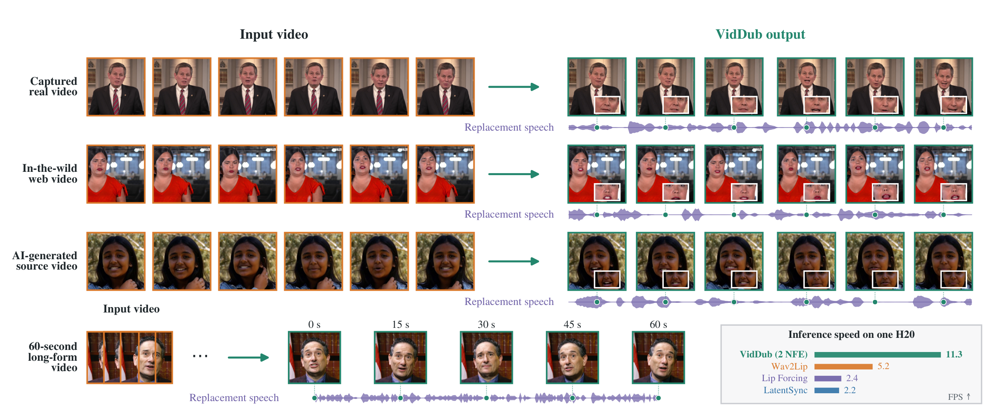

<div align="center">


<h3>Replacement-Aware Distillation for Two-Step Video Dubbing</h3>

<p>
  Preserve the recorded person, performance, and scene while transferring
  replacement-speech articulation with a full-context two-step editor.
</p>

<p>
  <a href="https://arxiv.org/abs/2611.03404"></a>
  <a href="https://law1223.github.io/viddub-project-page/"></a>
  <a href="https://github.com/LAW1223/VidDub"></a>
  <a href="https://github.com/LAW1223/OpenDub"></a>
  <a href="https://huggingface.co/AIPeanutman/VidDub"></a>
  <a href="https://huggingface.co/datasets/AIPeanutman/VidDub-Bench"></a>
  
  
  <a href="LICENSE"></a>
</p>

<p>
  <a href="#quick-start">Quick Start</a> ·
  <a href="#opendub-application">Application</a> ·
  <a href="#how-it-works">Method</a> ·
  <a href="#model-release">Model</a> ·
  <a href="#training-and-reproduction">Training</a> ·
  <a href="docs/ARCHITECTURE.md">Architecture</a> ·
  <a href="docs/BENCHMARK.md">Benchmark</a> ·
  <a href="docs/EVALUATION.md">Evaluation</a> ·
  <a href="AGENTS.md">AI / Contributor Guide</a> ·
  <a href="docs/RELEASE_VALIDATION.md">Validation</a>
</p>

</div>

<p align="center">
  
</p>
<p align="center"><sub>Audio-driven dubbing across captured, in-the-wild, generated, and 60-second long-form sources.</sub></p>

## Overview

> Source appearance should remain evidence—not become a conflicting target
> after the speech has been replaced.

VidDub is an audio-driven video-dubbing system designed for **replacement
speech**, rather than only same-audio reconstruction. The recorded mouth is a
consistent target when the audio is unchanged, but conflicts with the desired
articulation after speech replacement. VidDub masks source-mouth reconstruction
under unpaired audio while preserving the unmasked face and background, then
distills the resulting full-context teacher into a two-step student.

### Highlights

- **Efficient full-context generation:** two denoising steps with one
  audio-conditioned inference branch per step.
- **Replacement-aware supervision:** removes conflicting source-mouth reconstruction while
  retaining identity, pose, lighting, and background evidence.
- **Long-form inference:** overlapping 81-frame windows with a 64-frame
  stride and 17-frame overlap.
- **Reproducible benchmark:** 256 synthetic source clips with frozen same- and
  cross-audio assignments, per-item seeds, integrity receipts, and a batch
  runner.
- **Release tooling:** public preprocessing, training, inference, validation,
  and release-audit code. Dataset and benchmark media are separate artifacts
  subject to their own rights and redistribution review.

## How it works

1. **Replacement-aware full-context learning** retains full reconstruction for
   paired audio, but masks source-mouth reconstruction under replacement audio.
2. **Matched trajectory regression** transfers guided same- and cross-audio
   teacher trajectories into a two-step student.
3. **Distribution matching distillation** recovers visual quality after step
   compression while preserving non-mouth source content.
4. **Overlapping-window inference** applies the full-context model to long
   videos and blends overlapping predictions.

Masked source and reference inputs preserve appearance, frame-local audio
controls articulation, and bidirectional temporal attention jointly models each
complete window. Auxiliary score networks are removed at inference.

Evaluation results, benchmark protocols, and video comparisons are available
on the [project page](https://law1223.github.io/viddub-project-page/).
The frozen inputs and pairings are released as
[VidDub-Bench](https://huggingface.co/datasets/AIPeanutman/VidDub-Bench).

## News

- **2026-11-06:** [OpenDub](https://github.com/LAW1223/OpenDub), a browser-based
  end-to-end video translation and dubbing workbench, released.
- **2026-11-03:** Training code released.
- **2026-11-03:** Model weights released on [Hugging Face](https://huggingface.co/AIPeanutman/VidDub).
- **2026-11-02:** Paper released on [arXiv](https://arxiv.org/abs/2611.03404).

## Quick start

Requirements: Linux, Python 3.10+, FFmpeg, an NVIDIA CUDA GPU, and sufficient
GPU memory for the Wan/VACE stack. The development environment used PyTorch
2.7.1.

### 1. Install

```bash
git clone https://github.com/LAW1223/VidDub.git
cd VidDub
pip install -r requirements.txt
```

### 2. Download model weights

The VidDub model package contains the trained DiT, VACE, and audio adapter.
Wan/VACE base assets and Whisper are downloaded separately:

```bash
mkdir -p weights
huggingface-cli download Wan-AI/Wan2.1-VACE-1.3B \
  --local-dir weights/Wan2.1-VACE-1.3B
huggingface-cli download openai/whisper-small \
  --local-dir weights/whisper-small
huggingface-cli download AIPeanutman/VidDub \
  --local-dir weights/VidDub
```

### 3. Dub a video

```bash
python scripts/infer.py \
  --model weights/VidDub \
  --weight-root weights \
  --video input.mp4 \
  --audio replacement.wav \
  --output output.mp4
```

`--mode auto` is the default and exposes two inference paths:

- **Clip:** an exactly 81-frame input makes one full-context model call
  (`--mode clip` can enforce this contract).
- **Windowed:** longer inputs use overlapping full-context 81-frame windows
  with 64-frame stride, 17-frame overlap,
  per-window seeds, linear overlap blending, and lower-face color
  harmonization (`--mode windowed`).

For example, the explicit long-video form is:

```bash
python scripts/infer.py \
  --model weights/VidDub \
  --weight-root weights \
  --video long_input.mp4 \
  --audio replacement.wav \
  --output long_output.mp4 \
  --mode windowed
```

The source should contain a detectable, mostly front-facing face and be at
least 81 frames long. Audio is resampled to 16 kHz. The output keeps the source
frame rate and resolution. The reported Long-20 setting uses 25 FPS inputs;
other frame rates retain their native frame timing and are not the exact
Long-20 benchmark protocol. Color harmonization is enabled by default and can
be disabled for ablation with `--no-color-harmonization`.

The released full-context model fixes inference to two denoising steps.
Incompatible architecture overrides are rejected.

## OpenDub application

[OpenDub](https://github.com/LAW1223/OpenDub) is a separate, browser-based
workbench for end-to-end video translation and dubbing. It provides ASR,
translation, TTS, timeline editing, media composition, and a pluggable lip-sync
provider boundary for local, operator-controlled workflows.

OpenDub does not redistribute or currently wrap the released VidDub
full-context inference stack; use VidDub's CLI above for the public two-step
model. OpenDub's application code is Apache-2.0, but that license would not
replace the [VidDub license](LICENSE) for a future or custom VidDub adapter.
In particular, exposing VidDub inference to third parties through a hosted
service, website, API, bot, or managed deployment requires separate written
permission.

## Model release

The recommended artifact is `viddub-full2-dmd-r4-step100`, the paper-selected
full-context two-step checkpoint:

```text
r2a EMA@200
  -> FULL2_ODE_R3@400
  -> FULL2_DMD_R4@100
```

Checkpoint components are released atomically: never mix DiT, VACE, and adapter
files from different stages or steps. The Wan backbone is 1.3B parameters, the
adapted DiT/VACE/audio-adapter components contain 2.441B parameters, and the
complete benchmarked inference stack contains 2.81B parameters.

## Benchmark

Download and validate the frozen VidDub-Bench package:

```bash
huggingface-cli download AIPeanutman/VidDub-Bench \
  --repo-type dataset \
  --local-dir data/VidDub-Bench

python scripts/validate_benchmark.py --root data/VidDub-Bench
```

Run the released model over all fixed same- and cross-audio conditions without
reloading the model between clips:

```bash
python scripts/run_benchmark.py \
  --benchmark data/VidDub-Bench \
  --model weights/VidDub \
  --weight-root weights \
  --output outputs/VidDub-Bench \
  --condition both
```

See [docs/BENCHMARK.md](docs/BENCHMARK.md) for the manifest schema, smoke tests,
resumable/partitioned execution, reporting protocol, and license.

## Repository layout

```text
viddub/                    all model and training source code
  foundation/                reduced Wan2.1-VACE backend
  full_context/              full-context teacher training and inference
  causal/                    experimental causal ablations retained for research
    training/                causal AR, ODE, fake-score, and DMD objectives
data/                        preprocessing package and dataset contract
configs/                     published full-context and causal recipes
scripts/                     primary inference and release utilities
examples/                    release inference and explicitly labeled ablation examples
docs/                        architecture, training, evaluation, and release notes
dependencies/                upstream revisions, notices, and licenses
weights/                     public manifest; binary weights are external
```

## Environment configuration

Base model, data, and auxiliary assets are not vendored in Git. The default
layout uses `weights/` and `data/`; custom locations can be configured with:

```bash
export VIDDUB_WEIGHT_ROOT=/path/to/weights
export VIDDUB_LATENTSYNC_ROOT=/path/to/LatentSync
export VIDDUB_DATA_ROOT=/path/to/viddub-data
```

LatentSync/SyncNet checkpoints are required for preprocessing, training, and
paper metrics, but not all are needed for basic inference. See
`weights/README.md` for the expected files and environment variables.

## Training and reproduction

Detailed release recipes, exact selected checkpoints, resume rules, and
verification commands are in [docs/TRAINING.md](docs/TRAINING.md).

### Data preparation

Only use videos for which you can legally process and redistribute the intended
release fields. Start with a JSONL file described in `data/README.md`:

```bash
python -m data.s00_build_manifest --input /path/to/source.jsonl
python -m data.s01_analyze --shard 0 --num_shards 1
python -m data.s02_make_clips --shard 0 --num_shards 1
python -m data.s03_cache_latents --shard 0 --num_shards 1
```

The result is a 24 fps, 81-frame, 512x512 clip dataset with aligned 16 kHz
audio, a lower-face mask, a reference image, and cached model latents.

### Full-context teacher

Run from the repository root. A minimal two-stage example:

```bash
accelerate launch -m viddub.full_context.train \
  --output outputs/s1 \
  --stage s1 --num_frames 49 --max_steps 3000

accelerate launch -m viddub.full_context.train \
  --output outputs/s2 \
  --stage s2 --num_frames 81 --max_steps 6000 \
  --init_adapter outputs/s1/adapter_step003000.safetensors \
  --lr 5e-5 --lr_base 1e-5
```

The full research trainer exposes S3-style SyncNet/counterfactual/LPIPS/ART,
LoRA and EMA flags through `python -m viddub.full_context.train --help`.

### Full-context two-step student

The released recipe follows the paper's three model stages:

1. Train the replacement-aware full-context teacher with
   `viddub.full_context.train`.
2. Regress the two-step student on matched guided teacher trajectories.
3. Refine the two-step student with distribution matching distillation.

The legacy `viddub.causal` package is retained only for the full-context versus
causal ablation and is not the default VidDub release path.

## Evaluation and release checks

The release implementation is checked against the research implementation with
matched configurations, checkpoint-component hashes, and deterministic
full-context inference from the selected checkpoint.

These checks establish implementation and checkpoint parity; they are not an
independent reproduction of the full training run. See
[docs/RELEASE_VALIDATION.md](docs/RELEASE_VALIDATION.md) for the scope and
tolerances.

```bash
python -m pytest tests/test_release_contract.py -q
python scripts/audit_release.py --root .
```

## Scope and limitations

- Two denoising steps reduce sampling cost, but the public full-video
  implementation is offline and windowed. The reported 11.3 FPS is
  prepared-input throughput on one H20.
- The primary operating regime assumes one detectable, mostly front-facing
  face. Extreme pose, occlusion, multiple faces, severe source artifacts, and
  clips shorter than 81 frames can fail.
- Automatic synchronization and perceptual metrics do not establish human
  preference by themselves.

## Responsible use

Use VidDub only with media and identities for which you have permission.
Do not use it for impersonation, fraud, harassment, non-consensual content, or
deceptive political or media manipulation. Disclose edited media and preserve
provenance or watermarking where appropriate.

## Contact

For questions about VidDub, contact Yexin Liu at
[yliu292@connect.ust.hk](mailto:yliu292@connect.ust.hk).

## Citation

If you find VidDub useful, please cite:

```bibtex
@article{liu2026viddub,
  title   = {VidDub: Replacement-Aware Distillation for Two-Step Video Dubbing},
  author  = {Liu, Yexin and Lin, Yunlong and Wang, Zehan and He, Guangxin and
             Xu, Xinli and Zha, Jiajun and Liu, Yaofu and Wang, Yueze and
             Ping, Bowen and Li, Yuanming and Wang, Amie and Ghanem, Bernard and
             Li, Bing and Yang, Harry},
  journal = {arXiv preprint arXiv:2611.03404},
  year    = {2026}
}
```

## License and acknowledgements

VidDub project code and released model components are available under the
[VidDub Individual Commercial and Research License](LICENSE). Individuals
may use VidDub personally or commercially, including monetizing completed
outputs and project-based creative work. Non-commercial academic research is
also permitted. Use on behalf of a company and providing VidDub through
SaaS, hosted inference, an API, web application, bot, platform integration, or
other managed/remote service require separate written permission. This is a
source-available license, not an open-source license.

The reduced `viddub/foundation/` backend is derived from the pinned Wan/VACE
upstream revision recorded under `dependencies/`; the adapted
causal-consistency code carries its own notice. Those identified third-party
components remain under Apache-2.0, whose text is retained at
`dependencies/licenses/Apache-2.0.txt`.

This project builds on Wan2.1-VACE, Whisper, LatentSync/SyncNet, and related
open research listed in the paper. Base models, auxiliary checkpoints, dataset
media, and release weights are separate artifacts whose licenses and usage
terms apply independently.
